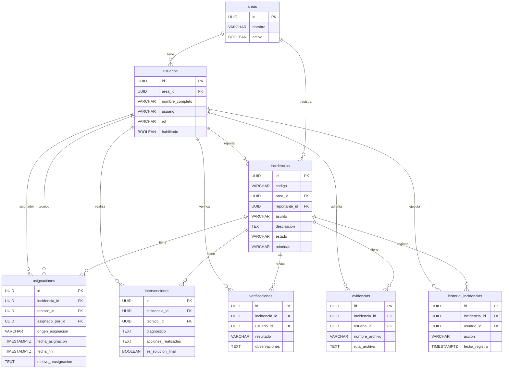

# Diagrama Entidad-Relación - Sistema de Soporte TI

## Proyecto

Sistema de Gestión y Seguimiento de Incidencias de Soporte TI - Municipalidad Distrital de Grocio Prado.

## Modelo entidad-relación del MVP

El modelo contempla ocho entidades principales para registrar, asignar, atender y dar seguimiento a las incidencias tecnológicas.

## Consideraciones

- Cada incidencia pertenece a un área municipal.
- Cada incidencia tiene un usuario reportante.
- Una incidencia puede tener varias asignaciones e intervenciones.
- Cada asignación identifica al técnico y al usuario que asignó.
- Las evidencias y verificaciones están vinculadas a una incidencia.
- El historial permite consultar las acciones realizadas.
- El diagrama presenta atributos principales; el diccionario contiene el detalle completo.

### Asignación y toma de incidencias

- El jefe de Sistemas puede asignar y reasignar incidencias.
- El asistente y practicante pueden tomar incidencias sin responsable.
- Una incidencia solo puede tener una asignación activa.
- El origen de la asignación será JEFATURA o AUTOTOMA.
- Una incidencia tomada por un técnico quedará asignada a ese mismo usuario.
- Solo el jefe podrá reasignar incidencias previamente asignadas.
- Todas las asignaciones y reasignaciones conservarán su historial.
- No es necesario controlar la ausencia o disponibilidad del jefe.

## Estado

Modelo entidad-relación preliminar del MVP.

Pendiente de validar las restricciones de integridad y generar el script SQL de PostgreSQL.
